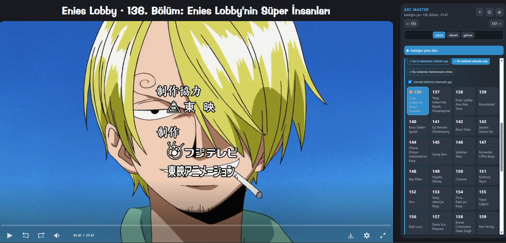

# OnePace Utilities

> A focused, multilingual viewing companion for OnePaceTR, AnimPow, and TRanimeizle.

[English](#english) · [Türkçe](#türkçe) · [Español](#español)



---

## English

OnePace Utilities is a Chromium extension that improves the viewing experience on OnePaceTR, and on One Piece episodes at AnimPow and TRanimeizle. It turns the episode page into a focused player layout and adds an **Arc Master** panel for navigating arcs, tracking progress, resuming episodes, and managing playback preferences.

### Features

- Focused layout with a larger player and fewer distractions
- Arc and episode navigation from the Arc Master panel
- Automatic watch-progress tracking and resume support
- Completed, in-progress, and untouched episode states
- Mark a single episode or an entire arc as completed
- Mark every episode through the current episode as watched
- Reset the progress of the current episode
- Export and safely merge progress and settings backups
- Optional automatic playback of the next episode
- Configurable episode start time and playback speed
- Quick switching between supported video sources: Clone, Sibnet, and Google Drive
- Manga and anime source references when provided by OnePaceTR
- Interface languages: English, Turkish, and Spanish

#### AnimPow and TRanimeizle

On these sites, Arc Master groups One Piece episodes by story arc and tags canon, mixed, filler, and anime-canon episodes. The panel there is in Turkish.

- The same focused layout, progress tracking, resume, start time, and playback speed
- 15-second seek buttons and ← / → shortcuts
- A **next episode** button over the player during the last 30 seconds. Using it marks the episode as watched. If the episode simply ends, the next one starts after a 5-second countdown.
- AnimPow: an optional setting that blocks the site's online-user WebSocket
- TRanimeizle: the first video source is selected automatically, through the site's pre-video screen
- TRanimeizle: the fansub row, hidden ad players and the transparent click-catching layer over the player are removed, so one click starts playback
- One Piece episode titles on the episode cards and under the current episode, in Turkish, English, or Spanish (following the browser language). English and most Spanish titles come from Wikipedia; Turkish titles and the remaining Spanish ones are translations.

### Installation

#### From a release

1. Download `onepace-utilities.zip` from the [latest release](https://github.com/unseensenpai/onepace-utilities/releases/latest).
2. Extract the ZIP file to a permanent folder.
3. Open your Chromium-based browser's extensions page:
   - Chrome: `chrome://extensions`
   - Edge: `edge://extensions`
   - Brave: `brave://extensions`
4. Enable **Developer mode**.
5. Select **Load unpacked** and choose the extracted folder containing `manifest.json`.
6. Open an episode on OnePaceTR, AnimPow, or TRanimeizle. The extension activates automatically.

#### From source

```sh
git clone https://github.com/unseensenpai/onepace-utilities.git
cd onepace-utilities
```

Enable **Developer mode** on your browser's extensions page, select **Load unpacked**, and choose the repository folder.

### Usage

Open any episode page on a supported site. Arc Master appears beside the player and highlights the active arc and episode. Use the gear button to change the language, resume behavior, episode start time, playback speed, and automatic next-episode setting.

Progress and preferences are stored through the browser extension storage APIs. The extension requires access to the supported sites and their embedded players to synchronize playback state and apply your preferences.

---

## Türkçe

OnePace Utilities, OnePaceTR ile AnimPow ve TRanimeizle'deki One Piece bölümlerinde izleme deneyimini geliştiren Chromium tabanlı bir tarayıcı eklentisidir. Bölüm sayfasını daha odaklı bir oynatıcı düzenine dönüştürür; arc ve bölüm gezintisi, ilerleme takibi, kaldığın yerden devam etme ve oynatıcı tercihleri için **Arc Master** panelini ekler.

### Özellikler

- Daha büyük oynatıcı ve daha az dikkat dağıtan odaklı görünüm
- Arc Master panelinden arc ve bölüm gezintisi
- Otomatik izleme ilerlemesi kaydı ve kaldığın yerden devam etme
- Tamamlanan, devam eden ve henüz başlanmayan bölüm durumları
- Tek bir bölümü veya bütün bir arc'ı tamamlandı olarak işaretleme
- Geçerli bölüme kadar tüm bölümleri izlendi olarak işaretleme
- Geçerli bölümün ilerlemesini sıfırlama
- İlerleme ve ayar yedeklerini dışa aktarma ve güvenle birleştirerek içe aktarma
- İsteğe bağlı otomatik sonraki bölüm oynatma
- Ayarlanabilir bölüm başlangıç zamanı ve oynatma hızı
- Desteklenen video kaynakları arasında hızlı geçiş: Clone, Sibnet ve Google Drive
- OnePaceTR tarafından sunulduğunda manga ve anime kaynak bilgileri
- Türkçe, İngilizce ve İspanyolca arayüz desteği

#### AnimPow ve TRanimeizle

Bu sitelerde Arc Master, One Piece bölümlerini hikâye arc'larına göre gruplar ve canon, karışık, filler ve anime canon bölümleri işaretler. Panel bu sitelerde Türkçedir.

- Aynı odaklı görünüm, ilerleme takibi, kaldığın yerden devam, başlangıç zamanı ve oynatma hızı
- 15 saniye ileri/geri sarma düğmeleri ve ← / → kısayolları
- Son 30 saniyede oynatıcının üzerinde **sıradaki bölüm** düğmesi; basınca bölüm izlendi sayılır. Bölüm kendiliğinden biterse sıradaki bölüm 5 saniyelik geri sayımla açılır.
- AnimPow: sitenin çevrimiçi kullanıcı WebSocket bağlantısını engelleyen isteğe bağlı ayar
- TRanimeizle: ilk video kaynağı, sitenin ön video ekranı da geçilerek otomatik seçilir
- TRanimeizle: fansub satırı, gizli reklam oynatıcıları ve oynatıcının üstündeki görünmez tıklama katmanı kaldırılır; oynatma tek tıkla başlar
- Bölüm kartlarında ve mevcut bölümün altında One Piece bölüm isimleri; tarayıcı diline göre Türkçe, İngilizce veya İspanyolca. İngilizce ve İspanyolca isimlerin çoğu Wikipedia'dan gelir; Türkçe isimler ve kalan İspanyolca isimler çeviridir.

### Kurulum

#### Sürüm paketinden

1. [En son sürümden](https://github.com/unseensenpai/onepace-utilities/releases/latest) `onepace-utilities.zip` dosyasını indir.
2. ZIP dosyasını kalıcı bir klasöre çıkar.
3. Chromium tabanlı tarayıcının eklentiler sayfasını aç:
   - Chrome: `chrome://extensions`
   - Edge: `edge://extensions`
   - Brave: `brave://extensions`
4. **Geliştirici modu** seçeneğini etkinleştir.
5. **Paketlenmemiş öğe yükle** seçeneğine bas ve `manifest.json` dosyasını içeren klasörü seç.
6. OnePaceTR, AnimPow veya TRanimeizle üzerinde bir bölüm aç. Eklenti otomatik olarak etkinleşir.

#### Kaynak koddan

```sh
git clone https://github.com/unseensenpai/onepace-utilities.git
cd onepace-utilities
```

Tarayıcının eklentiler sayfasında **Geliştirici modu** seçeneğini etkinleştir, **Paketlenmemiş öğe yükle** seçeneğine bas ve depo klasörünü seç.

### Kullanım

Desteklenen bir sitede herhangi bir bölüm sayfasını aç. Arc Master oynatıcının yanında görünür; etkin arc ve bölümü vurgular. Dil, kaldığın yerden devam etme davranışı, bölüm başlangıç zamanı, oynatma hızı ve otomatik sonraki bölüm ayarlarını değiştirmek için dişli düğmesini kullan.

İzleme ilerlemesi ve tercihler tarayıcı eklentisinin depolama API'leri aracılığıyla saklanır. Eklenti, oynatma durumunu eşitlemek ve tercihlerini uygulamak için desteklenen sitelere ve gömülü oynatıcılarına erişim ister.

---

## Español

OnePace Utilities es una extensión para navegadores basados en Chromium que mejora la experiencia de reproducción en OnePaceTR y en los episodios de One Piece de AnimPow y TRanimeizle. Convierte la página del episodio en una vista centrada en el reproductor y añade un panel **Maestro de Arcos** para navegar por arcos y episodios, registrar el progreso, reanudar la reproducción y gestionar las preferencias del reproductor.

### Funciones

- Vista enfocada con un reproductor más grande y menos distracciones
- Navegación por arcos y episodios desde el panel Maestro de Arcos
- Registro automático del progreso y reanudación de episodios
- Estados para episodios completados, en curso y no iniciados
- Opción para marcar un episodio o un arco completo como visto
- Opción para marcar como vistos todos los episodios hasta el episodio actual
- Restablecimiento del progreso del episodio actual
- Exportación e importación segura de copias del progreso y los ajustes
- Reproducción automática opcional del siguiente episodio
- Tiempo de inicio y velocidad de reproducción configurables
- Cambio rápido entre las fuentes de vídeo compatibles: Clone, Sibnet y Google Drive
- Referencias del manga y del anime cuando OnePaceTR las proporciona
- Interfaz disponible en español, inglés y turco

#### AnimPow y TRanimeizle

En estos sitios, el Maestro de Arcos agrupa los episodios de One Piece por arcos y marca los episodios canon, mixtos, de relleno y canon del anime. Allí el panel está en turco.

- La misma vista enfocada, registro del progreso, reanudación, tiempo de inicio y velocidad de reproducción
- Botones para avanzar o retroceder 15 segundos y atajos ← / →
- Un botón de **siguiente episodio** sobre el reproductor durante los últimos 30 segundos, que marca el episodio como visto. Si el episodio termina sin más, el siguiente empieza tras una cuenta atrás de 5 segundos.
- AnimPow: un ajuste opcional que bloquea el WebSocket de usuarios en línea del sitio
- TRanimeizle: la primera fuente de vídeo se selecciona automáticamente, pasando por la pantalla previa del sitio
- TRanimeizle: se eliminan la fila de fansubs, los reproductores de anuncios ocultos y la capa transparente que capturaba el primer clic sobre el reproductor, así que un solo clic inicia la reproducción
- Títulos de los episodios de One Piece en las tarjetas y bajo el episodio actual, en turco, inglés o español (según el idioma del navegador). Los títulos en inglés y la mayoría de los españoles vienen de Wikipedia; los turcos y el resto de los españoles son traducciones.

### Instalación

#### Desde una versión publicada

1. Descarga `onepace-utilities.zip` desde la [última versión](https://github.com/unseensenpai/onepace-utilities/releases/latest).
2. Extrae el archivo ZIP en una carpeta permanente.
3. Abre la página de extensiones de tu navegador basado en Chromium:
   - Chrome: `chrome://extensions`
   - Edge: `edge://extensions`
   - Brave: `brave://extensions`
4. Activa el **Modo de desarrollador**.
5. Selecciona **Cargar descomprimida** y elige la carpeta extraída que contiene `manifest.json`.
6. Abre un episodio en OnePaceTR, AnimPow o TRanimeizle. La extensión se activará automáticamente.

#### Desde el código fuente

```sh
git clone https://github.com/unseensenpai/onepace-utilities.git
cd onepace-utilities
```

Activa el **Modo de desarrollador** en la página de extensiones del navegador, selecciona **Cargar descomprimida** y elige la carpeta del repositorio.

### Uso

Abre cualquier página de episodio en un sitio compatible. El Maestro de Arcos aparecerá junto al reproductor y resaltará el arco y el episodio activos. Usa el botón del engranaje para cambiar el idioma, la reanudación, el tiempo de inicio, la velocidad de reproducción y el avance automático al siguiente episodio.

El progreso y las preferencias se guardan mediante las API de almacenamiento del navegador. La extensión necesita acceso a los sitios compatibles y a sus reproductores integrados para sincronizar la reproducción y aplicar tus preferencias.

---

## Development

Requires [Node.js](https://nodejs.org/) 22 or later.

```sh
npm test
```

Pushing a Git tag in the `v*` format runs the test suite and creates a ZIP archive and GitHub Release automatically.

## Compatibility

OnePace Utilities targets Chromium-based browsers and currently integrates with:

- OnePaceTR, with its Clone (AbyssPlayer), Sibnet, and Google Drive embeds
- AnimPow (`animpow.com`), whose player runs on the page itself
- TRanimeizle (`tranimeizle.live`, `tranimeizle.io`), with its AitrVip (`optraco.top`) embed tested. Sibnet and Google Drive embeds are supported too. Mail.ru, MixDrop, Vidmoly, Vudeo, Yourupload, and Mega are enabled but not yet tested.

## Disclaimer

This is an independent, community-made project. It is not affiliated with or endorsed by One Pace, OnePaceTR, AnimPow, TRanimeizle, Toei Animation, Shueisha, or any streaming provider. One Piece and related names and imagery belong to their respective owners.

## License

Released under the [MIT License](LICENSE).
